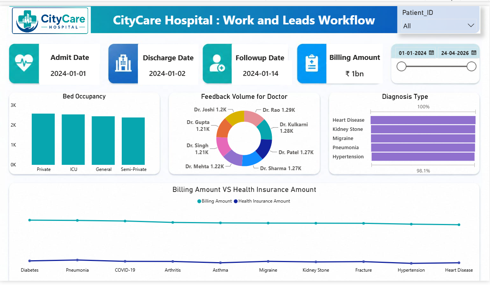

# CityCare Hospital: Power BI Dashboard

An interactive Power BI dashboard that tracks bed utilization, diagnosis trends, doctor feedback, and billing versus insurance coverage for a hospital.

**Tools:** Power BI Desktop, Microsoft Excel (data source)

## Dataset

- File: `Hospital_Management_Dataset.xlsx` (sheet: `Hospital_Data`)
- Size: 10,000 patient records × 11 columns
- Columns: Patient_ID, Admit_Date, Discharge_Date, Diagnosis, Bed_Occupancy, Test, Doctor, Followup_Date, Feedback, Billing_Amount, Health_Insurance_Amount
- Period covered: 1 Jan 2024 to 30 Apr 2026
- Data check: no missing values and no duplicate rows

## What the dashboard shows

| Visual | Purpose |
| --- | --- |
| KPI cards | Admit date, discharge date, follow-up date, and total billing amount |
| Slicers | Filter by Patient_ID and by admit-date range |
| Bed Occupancy (column chart) | Patients by bed type: Private, ICU, General, Semi-Private |
| Feedback Volume for Doctor (donut chart) | Feedback received by each of the 8 doctors |
| Diagnosis Type (funnel chart) | Share of patients by diagnosis |
| Billing Amount vs Health Insurance Amount (line chart) | Billing compared with insurance coverage for each diagnosis |

## Key insights

- **Bed utilization is balanced.** Private (2,596), ICU (2,550), General (2,456), and Semi-Private (2,398) beds are used at similar levels, so no bed type is clearly under- or over-used.
- **Diagnoses are evenly spread.** Each of the 10 diagnoses accounts for 977 to 1,049 patients. Diabetes (1,049) and COVID-19 (1,018) are the most common.
- **Insurance covers under half of billing.** Total billing is about ₹1.02 billion, and health insurance covers about ₹459 million, roughly 45%. The remaining amount is paid by patients or other sources.
- **Doctor feedback volume is similar across all 8 doctors**, at about 1.2K to 1.3K each, so no doctor stands out on this measure.

## How to use

1. Download `CityCare_Hospital_Dashbord (1).pbix`.
2. Open it in Power BI Desktop (free for Windows).
3. If Power BI asks for the data source, point it to `Hospital_Management_Dataset.xlsx`.

## Author

Shreya Hulawale | [LinkedIn](https://linkedin.com/in/shreya-hulawale-928259382) | [GitHub](https://github.com/hulawaleshreya-svg)
